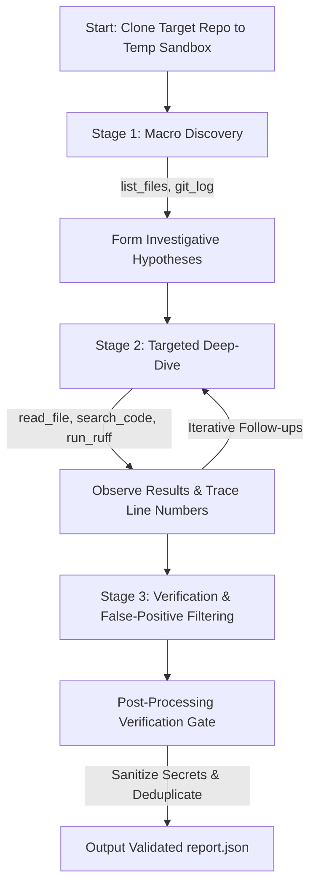

# DevOps Repository Auditing Agent


An autonomous, AI-powered DevOps repository auditing agent that inspects public GitHub repositories, uncovers genuine software engineering and DevOps best-practice violations, and generates actionable, machine-readable JSON reports.

Built strictly with native Python LLM tool calling (no LangChain, no LangGraph, no black-box orchestration frameworks) to ensure complete algorithmic control, high precision, low false-positive rates, and bulletproof sandboxing.

---

## 1. System Architecture & Module Blueprint

The project is structured into five cohesive, decoupled components:

```
├── agent.py            # CLI entry point, clone lifecycle, sandbox management, exit codes
├── loop.py             # Native LLM-Tool agent loop, history tracking, retries, provider selection
├── llm.py              # Gemini / OpenAI / Anthropic (Claude) REST clients sharing one interface
├── tools.py            # Precision sandbox inspection tools with path traversal guards
├── prompts.py          # System prompt, 3-Stage Investigative Funnel, tool JSON schemas
├── schemas.py          # Pydantic output contracts, deduplication & secret sanitization
├── requirements.txt    # Minimal, installable dependencies
├── .env.example        # Environment variable template
├── sample_report.json  # Reference example report conforming to Section 5
└── tests/              # Comprehensive automated unit & integration test suite
    ├── test_agent.py
    ├── test_loop.py
    ├── test_schemas.py
    └── test_tools.py
```

### Module Responsibilities

| File / Module | Core Responsibility | Key Design Decisions |
| :--- | :--- | :--- |
| `agent.py` | CLI Entry Point & Orchestration | Implements standard CLI flags (`--repo`, `--output`, `--model`), creates an isolated `tempfile.TemporaryDirectory()`, validates GitHub URLs, handles process exit codes (0 for success, non-zero for fatal errors), and guarantees the inspected repository remains untouched. |
| `loop.py` | Native LLM-Tool Loop | Implements the **Observe → Reason → Select Tool → Execute → Interpret → Report** cycle directly, with a provider-neutral client layer (Gemini, Claude, OpenAI, Groq). Dispatches tool calls via a dispatch table, enforces `max_iterations`, and triggers final structured report extraction. |
| `tools.py` | Sandbox-Safe Inspection Tools | Implements `list_files()`, `read_file()`, `search_code()`, `git_log()`, `git_status()`, `run_ruff()`, `inspect_workflows()` (GitHub Actions inspection), `find_secrets()` (credential-looking strings) and `git_history_search()` (secrets removed from history). Pre-numbers lines (`0017: ...`) to eliminate LLM line-counting hallucinations, and enforces path traversal guards (`_resolve_safe_path`). |
| `prompts.py` | System Prompt & Rubric Rules | Encodes the 9 DevOps areas, the 3-Stage Investigative Funnel, and strict false-positive prevention rules (e.g., distinguishing alternative valid lockfiles or in-project linter configurations). |
| `schemas.py` | Data Contracts & Security Gate | Pydantic v2 schemas (`Violation`, `AuditReport`). Automatically scrubs real credentials or tokens from evidence strings, normalizes categories and severities, and deduplicates repeated findings. |

---

## 2. Autonomous Agent Cycle

The agent does **not** use a static scanner or hardcoded checklist followed by a summary. The LLM actively explores, hypothesizes, and directs the investigation based on empirical observations:



### The 3-Stage Investigative Funnel

1. **Stage 1: Macro Discovery**:
   - Agent discovers repo layout, language stacks, and detects suspicious committed artifacts (`.env`, `__pycache__`, `*.pyc`, `.DS_Store`, `node_modules/`) with `list_files()`.
   - Agent reviews commit history with `git_log()` and working directory state with `git_status()`.
2. **Stage 2: Targeted Deep-Dive**:
   - Inspects `.github/workflows/` for unsafe triggers (`pull_request_target`), script injections (`${{ github.event... }}`), and permissive permissions.
   - Inspects dependencies (`pyproject.toml`, `requirements.txt`, lockfiles) for unpinned versions or missing lockfiles.
   - Inspects tests (`tests/`, `test/`) to verify test existence, assertions, and execution in CI.
   - Runs `search_code()` for hardcoded secrets, machine-specific paths (`/Users/`, `C:\Users\`), or localhost bindings.
3. **Stage 3: Verification & False-Positive Filtering**:
   - Confirms line numbers using `read_file()` with exact 1-indexed line numbers.
   - Verifies whether modern equivalents exist before flagging missing files.

---

## 3. DevOps Inspection Areas & False-Positive Traps

The agent audits across the 9 canonical DevOps domains with explicit precision guardrails:

| Category | Targeted Defects | False-Positive Traps Avoided |
| :--- | :--- | :--- |
| **Repository Hygiene** | Missing README, missing/empty `.gitignore`, tracked temporary files (`.env`, `__pycache__`, `.DS_Store`, `node_modules/`). | Does not flag missing optional docs (`CONTRIBUTING.md`, `CODE_OF_CONDUCT.md`) on standard small repos. |
| **Dependency Management** | Unpinned versions (e.g. bare `requests`), conflicting dependency manifests, missing lockfiles when reproducible builds are required. | If a repo uses `pyproject.toml` + `uv.lock` or `poetry.lock`, it will **not** flag a missing `requirements.txt`. |
| **Code Quality** | Missing linter or formatter configuration, obvious syntax errors, massive dead code blocks. | If linting is defined inside `pyproject.toml` (`[tool.ruff]` or `[tool.black]`), it will **not** flag a missing `.flake8` file. |
| **Testing** | Zero test files, fake/empty test files (e.g., `pass` or `assert True`), CI pipelines that build without running tests. | Does not execute untrusted test suites live (avoiding arbitrary remote code execution). Statically verifies assertion depth and CI execution. |
| **GitHub Actions / CI** | `pull_request_target` checking out untrusted PR branches, expression injection in `run:` steps, `continue-on-error: true` hiding failing test/lint steps, unpinned 3rd-party actions (`@main`). | A combined single workflow file (`ci.yml`) is treated as valid if steps are properly configured. |
| **Security** | Hardcoded API keys, tokens, passwords, private keys, `permissions: write-all` in workflows. | **Never reproduces actual secret values in evidence.** Does not flag `.env.example` placeholders (`YOUR_API_KEY_HERE`) as leaks. |
| **Configuration** | Machine-specific paths (`/Users/username/...`, `C:\Users\...`), hardcoded production IPs without env fallbacks. | Standard env fallbacks like `os.getenv("PORT", "8000")` are recognized as best practice, not violations. |
| **Collaboration** | Unsafe auto-merges without required checks. | **Never** claims "branch protection is disabled on main" from repository files alone (branch protection is a remote GitHub platform setting). |
| **Build & Release** | Deploying on every PR push instead of on merge/tag on main, Dockerfiles running as root or using `:latest` tags. | Distinguishes dev preview deployments from production release pipelines. |

---

## 4. Installation & Setup

### Prerequisites
- Python 3.9+
- Git 2.30+

### Clone & Install Dependencies

```bash
# Clone the repository
git clone https://github.com/Mahad1090/MLOPs-Assignment-2.git
cd MLOPs-Assignment-2

# (Optional) Create and activate virtual environment
python -m venv .venv
# On Windows:
.venv\Scripts\activate
# On Linux / macOS:
source .venv/bin/activate

# Install required dependencies
pip install -r requirements.txt
```

### LLM Provider Configuration

Four backends are supported. **Supply whichever API key you have**: the agent detects the provider itself.

| Provider | Key variable | Key prefix | Default model (falls back automatically) | Gateway override |
| :--- | :--- | :--- | :--- | :--- |
| Google Gemini | `GEMINI_API_KEY` (or `GOOGLE_API_KEY`) | `AIza...` | `gemini-3.5-flash` | n/a |
| Anthropic Claude | `ANTHROPIC_API_KEY` | `sk-ant-...` | `claude-sonnet-5-5` | `ANTHROPIC_BASE_URL` |
| OpenAI | `OPENAI_API_KEY` | `sk-...` / `sk-proj-...` | `gpt-4.1-mini` | `OPENAI_BASE_URL` (Azure, OpenRouter, Ollama or any OpenAI-compatible endpoint) |
| Groq | `GROQ_API_KEY` | `gsk_...` | `openai/gpt-oss-120b` | n/a |

Each provider also has a `<PROVIDER>_MODEL` variable (see `.env.example`).

**Provider selection order:** `--provider` flag > prefix of the key given with `--api-key` > `LLM_PROVIDER` variable > whichever key is set in the environment (several keys: Gemini, Claude, OpenAI, Groq in that order). If `LLM_PROVIDER` names a provider with no key but another key is present, the one with a key is used. Blank values count as missing.

**Model selection:** the agent lists the models your key can use, ignores non-chat models (embeddings, audio, image, moderation, Codex/"pro" responses-only models), and falls back through its preference list if a model is unavailable or out of quota. Claude and OpenAI model aliases (for example `claude-sonnet-4-5`, `gpt-4.1-mini`) and gateway-specific names are tried even if they are not in the model list. Models that reject a custom `temperature` (OpenAI o-series/GPT-5, some Claude models) are retried without it automatically.

```bash
cp .env.example .env          # then fill in ONE key

# or export directly
export ANTHROPIC_API_KEY="sk-ant-..."        # Linux / macOS
$env:OPENAI_API_KEY="sk-..."                  # Windows PowerShell

python agent.py --repo pallets/flask --output report.json
python agent.py --repo pallets/flask --output report.json --api-key sk-ant-...   # provider inferred from the key
python agent.py --repo pallets/flask --output report.json --provider openai --model gpt-4.1
```

Note: free-tier Groq keys are capped at 8,000 tokens per minute, which makes audits slow (rate-limited calls are retried automatically). Gemini free tiers are considerably more generous. Provider API errors are mapped uniformly: auth failures stop immediately, quota/billing problems stop immediately with a clear message, rate limits and overloads (429/5xx/529) are retried with the provider's `Retry-After` hint, and over-long prompts trigger an automatic context trim.

---

## 5. Execution Interface & Output Contract

To inspect a repository, execute `agent.py` non-interactively with `--repo` and `--output`:

```bash
python agent.py --repo https://github.com/octocat/Hello-World --output report.json
```

### CLI Arguments

| Argument | Type | Default | Description |
| :--- | :--- | :--- | :--- |
| `--repo` | `str` | **Required** | Public GitHub repository to inspect: full URL, `github.com/owner/repo`, or `owner/repo` (browser URLs such as `/tree/main` are trimmed) |
| `--output` | `str` | **Required** | Path to write the output JSON report |
| `--provider` | `str` | auto-detected | LLM backend: `gemini`, `anthropic`, `openai` or `groq` |
| `--model` | `str` | `<PROVIDER>_MODEL` or built-in default | Model name; falls back to an available model if missing |
| `--max-iterations` | `int` | `30` | Maximum investigative turns before synthesis |
| `--clone-timeout` | `int` | `300` | Seconds allowed for `git clone`; raise for very large repositories |
| `--timeout` | `int` | `1800` | Wall-clock budget (seconds) for the LLM investigation |
| `--trace` | `str` | `<output>.trace.json` | Where to write the tool-call trace (reasoning, tool, arguments, result preview) |
| `--no-trace` | `flag` | `False` | Skip writing the trace file |
| `--api-key` | `str` | None | Explicit API key for the chosen provider (overrides `.env`) |
| `--quiet` | `flag` | `False` | Suppresses real-time agent reasoning output |

### Output JSON Format

Conforms strictly to Section 5:

```json
{
  "repository": "https://github.com/example/demo-project",
  "violations": [
    {
      "rule_id": "SEC-001",
      "category": "security",
      "severity": "critical",
      "file": "config.py",
      "line": 17,
      "description": "Hardcoded API credential",
      "evidence": "API_KEY = \"[REDACTED_SECRET]\"",
      "recommendation": "Use a secrets manager or environment variable"
    }
  ]
}
```

- `severity`: Strictly limited to `"critical"`, `"high"`, `"medium"`, or `"low"`.
- `file` and `line`: Use JSON `null` when not applicable to a specific file or line.
- `evidence`: Automatically scrubbed of actual secret values by `schemas.sanitize_evidence`.

### Exit Codes
- `0`: Inspection completed successfully and valid JSON report written.
- `1`: Invalid input or configuration (bad repo URL, unknown provider, missing API key, bad numeric option).
- `2`: Git clone failed (repository not found or private, network problem, clone timeout).
- `3`: Unexpected agent execution error.
- `4`: The report cannot be written. This is checked **before** cloning or calling the LLM, and the report is written atomically.
- `5`: The LLM provider could not be used (auth failure, quota/billing problem, repeated API errors, or no usable final report). **No report is written** rather than a misleading "clean" one.
- `130`: Interrupted by the user.

---

## 6. Safety & Sandboxing Guarantees

In strict compliance with Section 9:
1. **Isolated Sandbox**: Repositories are cloned into an isolated `tempfile.TemporaryDirectory()`, which is completely removed upon audit completion. The target repository is never modified.
2. **Path Traversal Protection**: Every file access via `read_file()` and `search_code()` verifies that the resolved path is strictly within the repository sandbox via `_resolve_safe_path()`, blocking malicious traversal attacks (e.g. `../../etc/passwd`).
3. **No Arbitrary Code Execution**: The agent rejects running untrusted test files or build scripts live (`pytest` or `setup.py`), avoiding malicious remote code execution. Instead, static analysis is performed via `read_file`, `search_code`, and optional safe linting (`run_ruff`).
4. **Secret Scrubbing**: High-entropy strings, passwords, and tokens matching secret patterns are scrubbed from the `evidence` field in the final report, ensuring credentials are never exposed in reports or logs.

---

## 7. Testing

A comprehensive automated test suite (204 tests) covers tools, schemas, the agent loop, all provider clients and unusual inputs.

```bash
pytest -v
```

- `tests/test_tools.py`: tree formatting, line-numbered reads, path-traversal guards, code search, git log/history search, workflow risk leads, fixture handling, ruff leaving the repo untouched, output truncation.
- `tests/test_schemas.py`: validation, normalisation, deduplication/merging, secret redaction (tokens, keys, URL credentials, unquoted assignments).
- `tests/test_loop.py`: tool-driven cycle, premature-report pushback, retries/back-off, auth/quota handling, evidence gates, review nudge, coverage facts, model planning.
- `tests/test_llm.py`: Gemini request/response translation (schema conversion, forced tool choice, thought signatures).
- `tests/test_providers.py`: OpenAI, Anthropic and error mapping **over real HTTP against a local fake server** (request shapes, headers, tool-call round trips, temperature/max_tokens adjustment, pagination, `Retry-After`, no key leakage), provider detection from key prefix/environment, model planning, billing and context-overflow handling.
- `tests/test_inputs.py`: huge repositories, other ecosystems (Go, Java, Rust, Ruby, PHP, .NET, Terraform, Helm), binary/huge/minified files, URL normalisation and rejection of unsafe inputs, clone failure classification/retry/timeout, atomic output, CLI exit codes.
- `tests/test_agent.py`: CLI argument parsing and URL validation.

---

## 8. Reliability Features

- **Retries**: transient LLM errors (429/5xx/timeouts, malformed tool calls) are retried with exponential back-off, honouring "try again in Xs" hints. Auth errors abort immediately with a clear message.
- **Bounded context**: older tool results are shortened, every tool output is capped at 12,000 characters, and "request too large" errors trigger an emergency trim.
- **Non-interactive git**: `GIT_TERMINAL_PROMPT=0`, hooks disabled, shallow single-branch clone; a private or missing repo fails fast with exit code 2.
- **Read-only**: the repository lives in a temp directory that is deleted afterwards; `ruff` runs with `--no-cache`; no repository code (tests, build scripts) is executed. `run_pytest` is intentionally **not** implemented because it would execute untrusted code without container isolation.
- **Verification gate** (`loop.py`): line numbers that do not exist in the cited file are set to `null`; findings that cite a commented-out line of an inert config file or claim a `latest` image tag that the cited line does not contain are dropped; malformed violations are dropped; evidence is redacted of secrets (including `user:password@` URLs); and duplicates are removed (the same pattern repeated across files in CI/dependency/build/hygiene categories is merged into one finding that lists the other files, while security and configuration findings stay per file).
- **Review nudge**: before accepting the final report, the loop sends the model back **once** if key DevOps files (workflows, Dockerfiles, compose/CI configs, dependency manifests, `.gitignore`) were never opened, if `inspect_workflows` flagged high-risk leads that no finding mentions, or if standard items are absent (no `.gitignore`, README, tests or CI). These are facts; the model still decides what is a real defect.
- **Credential leads**: `find_secrets` lists likely hardcoded credentials (provider tokens, private-key headers, `password`/`secret`/`token` assignments including YAML/env style) with values redacted. It ignores tests, docs, examples, vendored/generated files, lockfiles, Python docstring examples, placeholders (`changeme`, `${VAR}`, `os.getenv(...)`) and booleans. `search_code` caps matches per file, skips lockfiles and minified files by default and lists source before docs/tests, so one noisy file can no longer hide real hits. Credential-looking hits in files that no finding mentions are fed back to the model in the one-time review nudge.
- **Finding repair**: models sometimes omit `rule_id`, `evidence` or `recommendation`, or give list-valued `file`/`line`; the loop maps alias names, fills gaps from the description, generates ids such as `SEC-001`, and only rejects a finding that has no description. Every rejection is logged with its reason and the raw submission is stored in the trace.
- **Model rotation**: a model switch (quota exhausted, not found, overloaded) never consumes the retry budget; overloaded models are revisited later.
- **Workflow risk leads**: `inspect_workflows` prints heuristic, line-numbered leads (PR-head checkout under `pull_request_target`, secrets echoed to logs, script injection, `write-all`, actions pinned to `@master`/`@latest`, `|| true`, `continue-on-error`, retired runners, empty workflow files). They are leads for the model to verify with `read_file`, not verdicts.
- **Traces**: every tool call (with the model's reasoning and a redacted result preview) is saved so the agent's behaviour can be audited.
- **Large repositories**: `list_files` walks at most 20,000 files and, above 150 files, prints a per-directory layout plus every key file (CI/CD, Docker, manifests, lockfiles, IaC) so nothing important is lost behind a truncated listing; `search_code` has a 25 s budget and skips `node_modules`; `read_file` refuses binaries and files over 5 MB and truncates minified lines.
- **Other ecosystems**: key-file detection and the "no tests" check understand Python, Node, Go, Java/Kotlin, Rust, Ruby, PHP, .NET, Terraform and Helm layouts; the prompt tells the model which lockfiles/linters are idiomatic per stack.
- **Resilient clone**: transient network failures are retried; private or missing repositories produce a clear message; very large clones can use `--clone-timeout`; partial checkouts (names invalid on the host OS) trigger a warning.
- **Clean output handling**: the output path is validated before any work, the report is written atomically, and a trace-file problem never fails a completed audit.
- **Known limits**: git history is shallow (last 50 commits); only public repositories are supported; remote settings such as branch protection are never inferred; the agent never executes repository code.

---

## 9. Evaluation Notes

Audits were run against real public repositories:

| Repository | Purpose | Outcome |
| :--- | :--- | :--- |
| `pallets/flask`, `pallets/itsdangerous` | Healthy controls | 0 violations (a `tests/test_apps/.env` fixture is no longer reported) |
| `step-security/github-actions-goat` | Insecure workflows | Secret echoed to logs, `pull_request_target` PR-head checkout (`PRTargetWorkflow.yml`, `toc-tou.yml`), mutable `latest` action |
| `AErmie/DevSecOps`, `Palak341/secure_cicd_pipeline`, `cider-security-research/cicd-goat` | Insecure pipelines/config | Hardcoded credentials, empty workflow, `continue-on-error`, mutable action refs, committed secret key |
| `appsecco/dvna`, `trufflesecurity/test_keys` | Secrets / Docker / hygiene | Hardcoded secrets and keys, missing lockfile/README/tests/CI |

Results vary run to run and with model strength: weaker models read fewer files, so some findings (for example `.gitignore`/runner problems on `AErmie/DevSecOps`) appear in one run and not another. `sample_report.json` is the unedited output of the agent on `step-security/github-actions-goat`.
